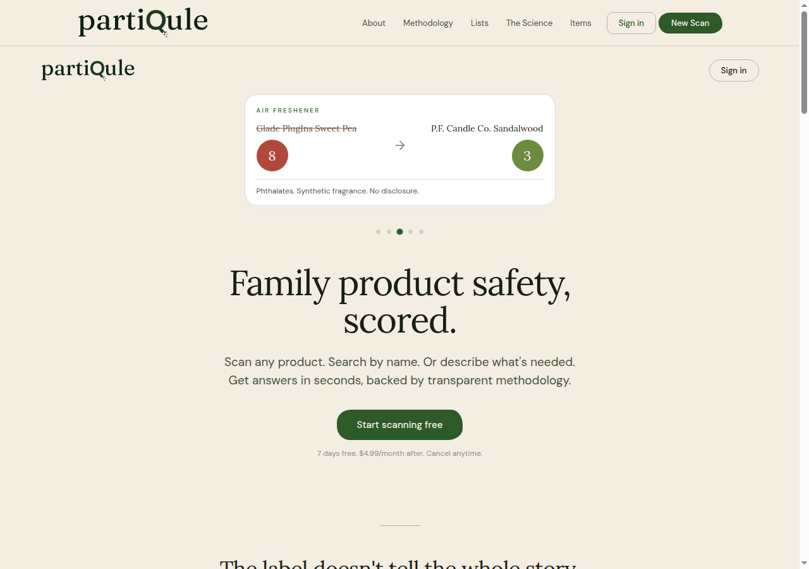

# Partiqule

Partiqule is a shopping tool. It scores everyday products from 1 to 10 so a buying decision is easier to make. Lower is safer. A person can search a name, scan a barcode, or photograph a label. The result explains the number. Kids mode and pregnancy mode apply stricter rules to the same ingredients. They are not medical advice. When a cleaner option is already in the library, it can be listed next to the score.

One score is free, with no account and no card. On the web, the first subscription is 7 days free and a card is required, then $4.99 a month. On iPhone, the price and any trial are whatever Apple shows on the payment sheet.

The public site is [partiqule.com](https://partiqule.com). The iOS app is on the App Store (`com.partiqule.app`). This repo is the whole product: the website, the API, and the iOS wrapper.

A longer, plain-language tour is in [docs/CODEBASE_MAP.md](docs/CODEBASE_MAP.md). That file also covers the security review and the iOS sign-in fix.



## What is interesting in the code

Most products never wait on a model. About 3,156 products have a hand-checked score in `backend/calibration.js`. Clothing is scored from the fiber label by `backend/textileScorer.js` (26 fibers, no model call). Personal care can be scored from the ingredient list by `backend/personalCareScorer.js`. `backend/foodScorer.js` is the same kind of rule scorer for food. A shopper sees it only where the server has promoted it. Otherwise an unknown food still uses the model.

A model (Claude Haiku) is the fallback when the product is not in that library and the ingredients had to be looked up. The API refuses to invent a confident score when it does not have the ingredients.

## Stack

| Piece | What it is |
| --- | --- |
| Website | React 18, Vite 5, one main UI file |
| API | Node.js, Express, `backend/server.js` |
| Accounts | Supabase Auth (email today, Sign in with Apple added for the iOS app) |
| Data | Supabase Postgres |
| Score cache | Upstash Redis, with a disk fallback |
| Payments | Stripe on the web, Apple In-App Purchase in the iOS app |
| iOS | Capacitor 8, bundle id `com.partiqule.app` |
| Hosting | Vercel (site), Railway (API) |

## Layout

```
backend/     API, scoring, calibration, database migrations
frontend/    React app, Vite build, Capacitor iOS project
frontend/plugins/apple-sign-in/   small native Sign in with Apple plugin
docs/        this review, screenshots, older design notes
```

The two big files are `frontend/src/App.jsx` and `backend/server.js`. The scoring logic that is worth reading sits in the smaller files next to `server.js`: `textileScorer.js`, `foodScorer.js`, `personalCareScorer.js`, `calibration.js`, `scoringCascade.js`.

## Run it locally

Node 18 or newer. This repo was checked on Node 22.

```bash
cd backend && npm install
cd ../frontend && npm install
```

Create `backend/.env` from `backend/.env.example`. The API starts without keys. `/health` works. A real scan needs more, because scoring is behind a sign-in wall:

- `SUPABASE_URL` and `SUPABASE_SERVICE_KEY` so the API can check the login token
- `ANTHROPIC_API_KEY` for any product that is not already in the calibration library
- A Supabase user whose subscription status is `trialing` or `active`

```bash
cd backend && node server.js          # http://localhost:3001
cd frontend && npm run dev            # http://localhost:3000
```

Checks that do not call paid APIs:

```bash
cd backend && npm test                # 141 scoring checks
cd frontend && node src/auth/nativeAuth.test.js
cd frontend && npm run build
```

`npm run build` also writes a static page per calibrated product into `frontend/public/products/`. Those pages are generated, not committed.

## iOS

The Xcode project is `frontend/ios`. After a web build:

```bash
cd frontend && npm run build && npx cap sync ios
```

Open `frontend/ios/App/App.xcodeproj` on a Mac. Signing team in the project is `39AMCG49RK`. This environment cannot compile the iOS app (no Xcode). The sign-in changes, and the Apple portal steps they depend on, are written up in [docs/CODEBASE_MAP.md](docs/CODEBASE_MAP.md).

## What is not in this repo

API keys, the Redis token, the Stripe secret, and the Apple private key. Those live in Railway, Vercel, Supabase, and the Apple Developer account. See the security section of the codebase map before you treat an old key as safe. Two credentials were committed in the past and should be rotated.

## Contact

paul@partiqule.com
